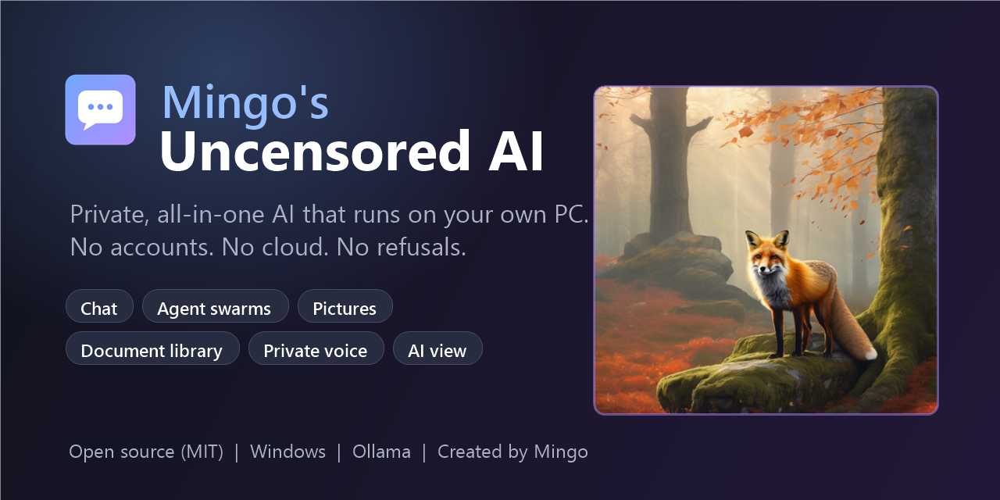
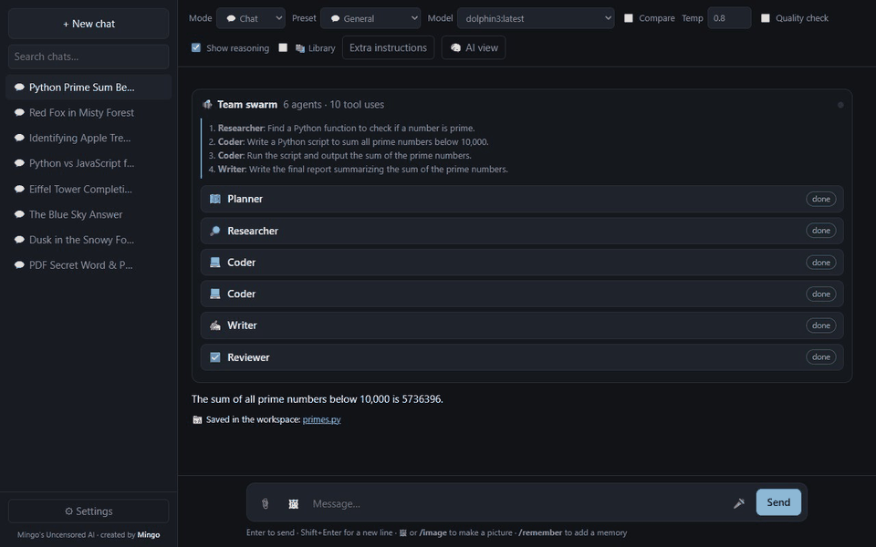
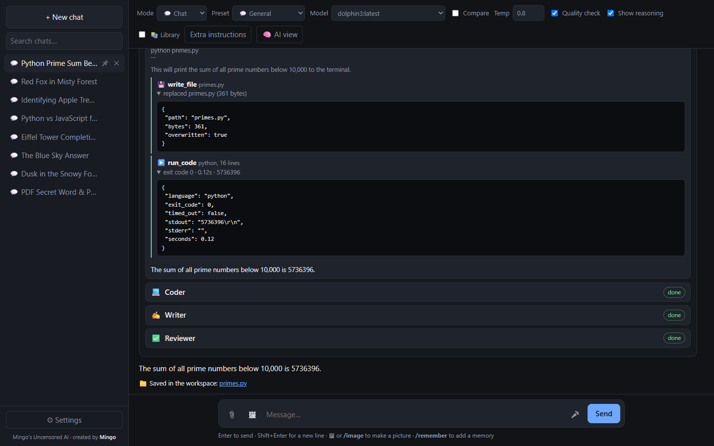
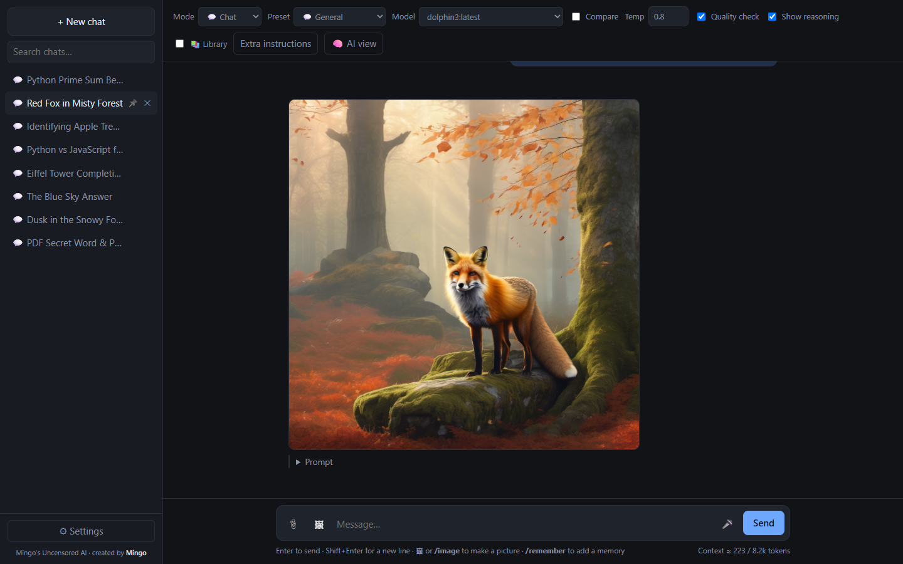
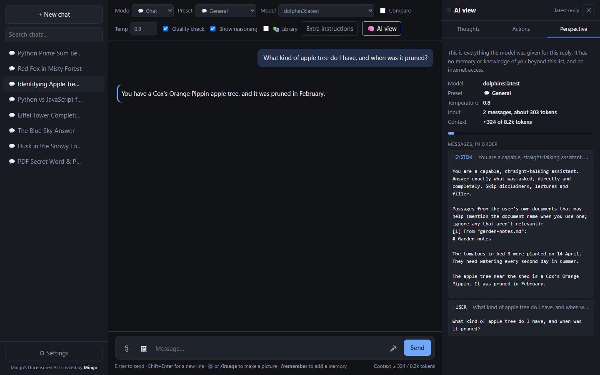
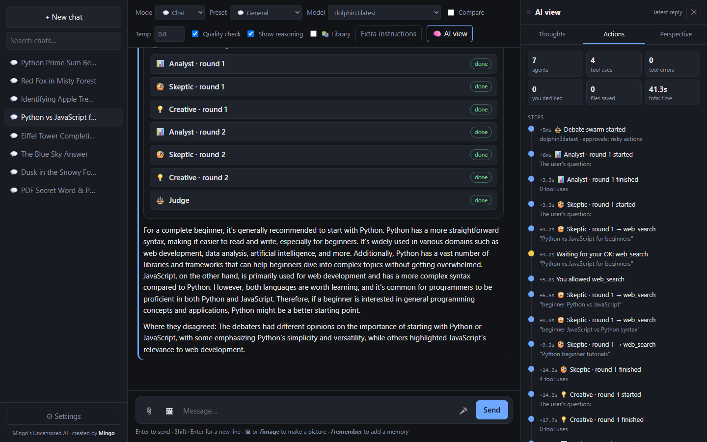
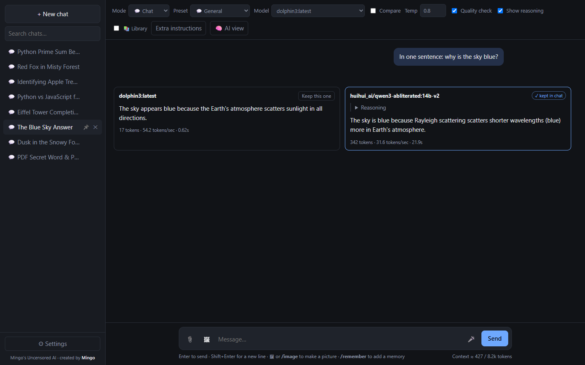
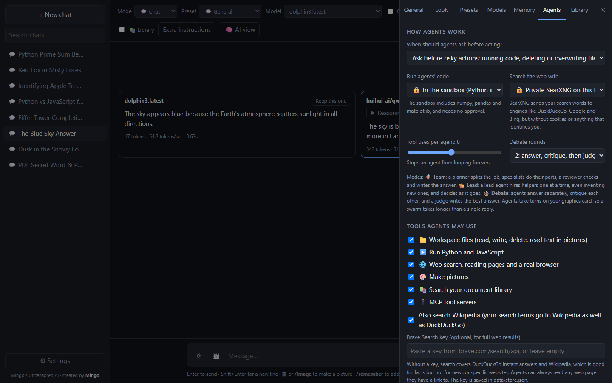

<p align="center">
  
</p>

<p align="center">
  <a href="https://github.com/TFFVanta/Mingos-Uncensored-Ai/actions/workflows/ci.yml"></a>
  <a href="LICENSE"></a>
  
  
  <a href="https://github.com/TFFVanta/Mingos-Uncensored-Ai/stargazers"></a>
</p>

<p align="center">
  
  <br><sub>Real, unedited use, with waiting time sped up: a question answered from your own documents, the 🧠 AI view, a picture, and an agent team that writes and runs code.</sub>
</p>

<p align="center">
  <a href="#install"><b>⬇️ Install</b></a> ·
  <a href="INSTRUCTIONS.md"><b>📖 User guide</b></a> ·
  <a href="#screenshots"><b>🖼️ Screenshots</b></a> ·
  <a href="#share-it"><b>📣 Share</b></a>
</p>

# Mingo's Uncensored AI

**Created by Mingo.** · [MIT License](LICENSE) · Version 1.0.1 · For adults (18+)

📖 **New here? Read the [user guide](INSTRUCTIONS.md)** for how to chat, make pictures, run agent swarms and more.

> **Using this software means agreeing to the [Terms of Use](TERMS.md) and [Acceptable Use Policy](ACCEPTABLE_USE.md).**
> The models are uncensored, and you're responsible for what you create. Sexual images of minors are always blocked.

## About

**Mingo's Uncensored AI is a private, all-in-one AI workspace that runs entirely on your own Windows PC,
using open models that answer you directly instead of refusing.**

It brings together, in one desktop app, what usually takes several online services: a chat assistant,
a team of AI agents that can research, write code and use tools, a picture generator, a searchable
library of your own documents, and voice input and output. Everything runs on your hardware. There
are no accounts, no subscriptions, no usage limits and no company reading your conversations.

### Why it exists

Most AI assistants run on someone else's servers, under someone else's rules. Your prompts are stored,
reviewed or used for training, and the assistant decides what you may ask about. That's fine for many
people, but it's a poor fit if you:

- **care about privacy**: confidential work, personal matters, journaling, health questions, client
  material, or anything you'd rather not send to a cloud company;
- **want straight answers** on subjects mainstream assistants hedge on or refuse: medicine and drugs,
  law, security research, sexuality, history, politics, or dark themes in fiction;
- **want control**: pick your own models, see exactly what the AI was told, keep working offline, and
  never lose access because a service changed its policy or its price.

Mingo's Uncensored AI was created by Mingo to give people that: a capable assistant that's entirely
yours.

### What "uncensored AI" means

Modern language models are usually trained twice: first to understand language and knowledge, then
"aligned" to follow company policies, which includes learning to **refuse** certain requests. Those
refusals are often useful, but they also misfire: assistants turn down harmless requests, moralize,
add disclaimers nobody asked for, or won't touch fiction, research or frank questions that are
perfectly legitimate.

An **uncensored** model has those trained-in refusals removed or reduced. The models this app uses by
default are **"abliterated"**. Researchers found that a model's tendency to refuse is mostly carried by
a single direction in its internal activations. Abliteration finds that "refusal direction" and
removes it from the model's weights. The result keeps the original model's knowledge and skills, but
it no longer refuses requests or lectures you: it just answers.

**What it does mean:**
- Direct answers without refusals, lectures or unnecessary warnings
- Fiction and roleplay that can go wherever the story needs, including dark or adult themes
- Frank discussion of sensitive topics: medical, legal, security, sexual, controversial
- Instructions in your presets and prompts are followed instead of second-guessed

**What it doesn't mean:**
- **Not smarter or more accurate.** An uncensored model knows exactly what the original model knew.
  It can still be wrong, make things up or be out of date.
- **Not lawless.** Removing a model's refusals doesn't change the law, and you're responsible for what
  you create and do with it. See the [Acceptable Use Policy](ACCEPTABLE_USE.md).
- **Not without any limits.** The app keeps one hard limit of its own: it will never generate sexual
  images involving minors.
- **Not a judgment-free advisor.** Without refusals, the model won't stop you from a bad idea.
  For decisions that matter, check with a qualified person.

### Who it's for

Writers and roleplayers who want a creative partner without guardrails getting in the way. Developers
and security researchers who want an assistant that discusses their work frankly. Researchers,
students and curious people who want direct answers. Anyone who wants an AI that's private by design.
It's for adults (18+) only.

## Screenshots

| | |
|---|---|
|  |  |
| **🐝 Agent swarms:** a team plans, writes and runs real code, then checks the answer | **🎨 Pictures:** describe it, the AI writes the prompt, SDXL draws it |
|  |  |
| **🧠 AI view + 📚 library:** see exactly what the model was given, including your documents | **⚖️ Debate mode:** agents argue it out, a judge decides, every step is logged |
|  |  |
| **Compare:** two models side by side, keep the better answer | **You're in control:** approvals, sandboxed code, private search, tools |

## Features

- **Chat** with any Ollama model: presets (Coder, Writer, Roleplay…), memory, edit/regenerate,
  compare two models side by side, file/PDF/image attachments, 6 themes.
- **🧠 AI view**: see the model's reasoning, every step it takes, and exactly what it was given.
- **Quality check**: replies are reviewed against each preset's expectations and fixed if needed.
- **Agent swarms**: 🐝 Team, 👑 Lead and ⚖️ Debate modes with an editable roster of agents.
  Tools: workspace files, sandboxed Python/JavaScript (Pyodide), web search (SearXNG), a real
  browser (Playwright + Edge), pictures, your document library, OCR, and MCP tool servers.
  Risky actions ask for approval first (configurable).
- **Pictures** with SDXL via ComfyUI: fast mode (SDXL-Lightning), style reference (IP-Adapter),
  outline guide (ControlNet canny), 2× upscaling (Real-ESRGAN).
- **📚 Library**: add documents and search them by meaning (nomic-embed-text).
- **Private voice**: speech-to-text with whisper.cpp, read-aloud with Piper.
- **Desktop app**: its own window and icon; closing it shuts everything down.

## Requirements

- Windows 10/11, an NVIDIA graphics card recommended (built and tested on an RTX 2060 12 GB)
- About 20 GB of free disk space for everything, or about 6 GB for chat only
- Microsoft Edge (for the app window and the agents' browser)
- The installer sets up the rest: [Node.js](https://nodejs.org) 22+, [Ollama](https://ollama.com) and Python 3.11

## Install

1. Download this repository (green **Code** button → **Download ZIP**) and unzip it somewhere permanent.
2. Double-click **`Install.cmd`** and choose the features you want.
3. Start **Mingo's Uncensored AI** from the new desktop shortcut.

The installer downloads each component from its official source, pinned to tested versions, and
verifies every file against its published fingerprint. It's safe to run again: anything already
installed is checked and skipped. Options:

```powershell
.\Install.cmd -DryRun                    # show what would happen, change nothing
.\Install.cmd -Yes                       # install the recommended set without questions
.\Install.cmd -Components core,voice     # just these (core, pictures, pictures-plus, voice, search, sandbox, ocr)
```

### Manual setup

```powershell
npm ci
ollama pull huihui_ai/qwen3-abliterated:8b
ollama pull nomic-embed-text
```

Then start it with `Start.cmd`, or make a shortcut to `LocalChat.ps1` for the desktop-app
window. Open http://localhost:3000 in a browser if you prefer.

The core chat works with just that. Each optional feature needs downloads that are **not in this
repository** (they're large and have their own licenses). Put them where Mingo's Uncensored AI expects them:

| Feature | What to download | Where it goes |
|---|---|---|
| Pictures | [ComfyUI portable for NVIDIA](https://github.com/Comfy-Org/ComfyUI/releases) + [SDXL base 1.0](https://huggingface.co/stabilityai/stable-diffusion-xl-base-1.0) | `image-engine/ComfyUI_windows_portable/` (model in `ComfyUI/models/checkpoints/`) |
| Fast pictures | [SDXL-Lightning 4-step LoRA](https://huggingface.co/ByteDance/SDXL-Lightning) | `…/models/loras/` |
| Outline guide | [ControlNet canny SDXL small](https://huggingface.co/diffusers/controlnet-canny-sdxl-1.0-small), saved as `controlnet-canny-sdxl-small.fp16.safetensors` | `…/models/controlnet/` |
| Style reference | [IP-Adapter SDXL ViT-H + image encoder](https://huggingface.co/h94/IP-Adapter), encoder saved as `CLIP-ViT-H-14-laion2B-s32B-b79K.safetensors`, plus [ComfyUI_IPAdapter_plus](https://github.com/cubiq/ComfyUI_IPAdapter_plus) | `…/models/ipadapter/`, `…/models/clip_vision/`, `ComfyUI/custom_nodes/` |
| Upscaling | [Real-ESRGAN x4plus](https://github.com/xinntao/Real-ESRGAN/releases) | `…/models/upscale_models/` |
| Code sandbox | [Pyodide core](https://github.com/pyodide/pyodide/releases) + numpy, pandas, matplotlib packages | `vendor/pyodide/` |
| OCR | [English traineddata](https://cdn.jsdelivr.net/npm/@tesseract.js-data/eng/4.0.0_best_int/eng.traineddata.gz) | `vendor/tessdata/` |
| Voice typing | [whisper.cpp Windows build](https://github.com/ggml-org/whisper.cpp/releases) + [ggml-base.en.bin](https://huggingface.co/ggerganov/whisper.cpp) | `voice/whisper/` |
| Read-aloud | [Piper for Windows](https://github.com/rhasspy/piper/releases) + [en_US-lessac-medium voice](https://huggingface.co/rhasspy/piper-voices) | `voice/piper/`, `voice/piper-voices/` |
| Web search | [SearXNG](https://github.com/searxng/searxng) source, in a Python 3.11 venv with its `requirements.txt` | `search-engine/searxng/`, `search-engine/venv/` |

For SearXNG on Windows: copy `search-engine/settings.example.yml` to `search-engine/settings.yml`
and set a random `secret_key`, then copy `search-engine/windows-fix/pwd.py` into
`search-engine/venv/Lib/site-packages/` (SearXNG imports a Unix-only module that this stands in for).

The Settings screens show which features are installed.

## Where things are kept

| Folder | Contents |
|---|---|
| `data/` | Your chats, presets, memory, library, pictures and logs (with an hourly backup of the chats) |
| `workspace/` | Files the agents create. Agents can't read or write anywhere else |

Both are excluded from git, so your conversations are never committed.

## Safety notes

- Agents' code runs in a WebAssembly sandbox by default, with no access to your PC or the internet.
  The "run on your PC" option runs code with your Windows account's permissions.
- The server only listens on `127.0.0.1`, rejects requests from other websites, and requires a
  per-session key for private endpoints.
- Abliterated models have had their refusals removed. They'll follow instructions they would
  otherwise decline, and they can still be wrong: check anything important.

## Legal

| Document | |
|---|---|
| [LICENSE](LICENSE) | MIT License for this project's code |
| [TERMS.md](TERMS.md) | Terms of Use |
| [ACCEPTABLE_USE.md](ACCEPTABLE_USE.md) | What the software may not be used for |
| [PRIVACY.md](PRIVACY.md) | What's stored, and what goes online only when you use a feature |
| [DISCLAIMER.md](DISCLAIMER.md) | Limits of AI output and agents |
| [THIRD_PARTY_NOTICES.md](THIRD_PARTY_NOTICES.md) | Licenses of the tools and models it uses |

These documents are also readable in the app (⚙ Settings → General → About).

## Contributing

See [CONTRIBUTING.md](CONTRIBUTING.md) and the [Code of Conduct](CODE_OF_CONDUCT.md). Run the tests with
`npm test`. Found a security problem? Please report it privately, as described in [SECURITY.md](SECURITY.md).
Changes are listed in the [CHANGELOG](CHANGELOG.md).

## Share it

If Mingo's Uncensored AI is useful to you, a ⭐ on GitHub and a share help other people find it.

<p>
  <a href="https://www.reddit.com/submit?url=https%3A%2F%2Fgithub.com%2FTFFVanta%2FMingos-Uncensored-Ai&title=Mingo%27s%20Uncensored%20AI%3A%20private%2C%20all-in-one%20uncensored%20AI%20that%20runs%20on%20your%20own%20PC"></a>
  <a href="https://twitter.com/intent/tweet?text=Mingo%27s%20Uncensored%20AI%3A%20private%2C%20all-in-one%20uncensored%20AI%20that%20runs%20on%20your%20own%20PC&url=https%3A%2F%2Fgithub.com%2FTFFVanta%2FMingos-Uncensored-Ai"></a>
  <a href="https://news.ycombinator.com/submitlink?u=https%3A%2F%2Fgithub.com%2FTFFVanta%2FMingos-Uncensored-Ai&t=Mingo%27s%20Uncensored%20AI%3A%20a%20private%2C%20local%20AI%20workspace%20for%20Windows"></a>
  <a href="https://bsky.app/intent/compose?text=Mingo%27s%20Uncensored%20AI%3A%20private%2C%20all-in-one%20uncensored%20AI%20that%20runs%20on%20your%20own%20PC%20https%3A%2F%2Fgithub.com%2FTFFVanta%2FMingos-Uncensored-Ai"></a>
  <a href="https://www.linkedin.com/sharing/share-offsite/?url=https%3A%2F%2Fgithub.com%2FTFFVanta%2FMingos-Uncensored-Ai"></a>
  <a href="https://www.facebook.com/sharer/sharer.php?u=https%3A%2F%2Fgithub.com%2FTFFVanta%2FMingos-Uncensored-Ai"></a>
  <a href="https://wa.me/?text=Mingo%27s%20Uncensored%20AI%3A%20private%2C%20all-in-one%20uncensored%20AI%20that%20runs%20on%20your%20own%20PC%20https%3A%2F%2Fgithub.com%2FTFFVanta%2FMingos-Uncensored-Ai"></a>
  <a href="https://t.me/share/url?url=https%3A%2F%2Fgithub.com%2FTFFVanta%2FMingos-Uncensored-Ai&text=Mingo%27s%20Uncensored%20AI%3A%20private%2C%20all-in-one%20uncensored%20AI%20that%20runs%20on%20your%20own%20PC"></a>
</p>

Or just copy the link: **https://github.com/TFFVanta/Mingos-Uncensored-Ai**

Want to post about it somewhere? [SHARE.md](SHARE.md) has ready-made posts for Reddit, Hacker News, X and Discord.

## Credits

**Mingo's Uncensored AI** was created by **Mingo**.

It's built on these open-source projects: Ollama, ComfyUI, Stable Diffusion XL, SDXL-Lightning,
ControlNet, IP-Adapter, Real-ESRGAN, SearXNG, Pyodide, Playwright, tesseract.js, whisper.cpp, Piper,
nomic-embed-text and the Model Context Protocol SDK. The default chat models are abliterated
versions published by huihui_ai on the Ollama library.

## License notes

This repository contains only Mingo's Uncensored AI's own code. The tools it uses keep their own licenses
(for example SearXNG is AGPL-3.0, ComfyUI is GPL-3.0, and each model has its own license).
